# Roadmap

> 中文导读: DeepGraph 的定位是自主科研的裁判, 不是第 10001 个作者。路线分三段:
> V1.0 一台可信的仪器 (已有); V1.5 让它持续、诚实、便宜地对外运转 (现在);
> V2 把诚信链收成一小组不变量 + 插件 API 的平台 (建设中)。终局是 benchmark x harness
> 交错进化, 它跑在 DeepGraph 之上。

```mermaid
flowchart LR
  subgraph V10["V1.0: a trustworthy instrument (shipped)"]
    A1["literature -> evidence graph"]
    A2["falsifiable plan bound to a runner"]
    A3["metered execution under ResourceGrant"]
    A4["evidence ladder: preregistration, equal budget,<br/>frozen holdout, paired permutation test,<br/>cross-vendor review, immutable ledger"]
  end
  subgraph V15["V1.5: keep it running honestly (now)"]
    B1["API inference, daily budget caps,<br/>status lights only on real output"]
    B2["model trust report cards:<br/>claimed vs measured, and how much<br/>a score collapses under meaning-preserving rewrites"]
    B3["candidates as reasoning scaffolds,<br/>not only prompts"]
  end
  subgraph V2["V2: thin integrity core + plugin API (building)"]
    C1["6 invariants + 1 loop as a plugin core,<br/>on an open agent-harness substrate"]
    C2["runner / evaluator / benchmark / scaffold /<br/>agenda / metric / selector plugins"]
    C3["learning layer: verdicts feed selection<br/>(shadow first, then bounded online)"]
  end
  V10 --> V15 --> V2
  V2 -.->|"runs on top"| G["benchmark x harness co-evolution"]
```

## What V1.0 is, and is not

V1.0 is an auditable, operator-governed research control plane that has run
the full chain end to end: it turns literature into an evidence graph, turns
an opening into a falsifiable plan bound to a runner that can execute it, runs
it under a metered grant, and applies a fail-closed evidence ladder that
refuses a verdict when the comparison is unfair, the baseline is missing or
zero, the holdout overlaps, or the independent reviewer dissents.

Its real capability is not "it runs experiments"; it is "it does not fool
itself". The ladder has caught an unequal-budget comparison that would have
recorded a worse-than-baseline method as confirmed, a global verdict bug
surfaced by a dissenting cross-vendor reviewer, a contaminated holdout the
system produced itself, and eleven verdicts built on empty outputs (retracted,
not deleted).

Boundaries, stated plainly: the instrument today adjudicates single-turn,
per-sample-scored claims about language models (a prompt or an input
transformation against a public dataset). It does not train, does not run
multi-turn tool agents, and does not run arbitrary programs. Hypotheses the
system invents on its own have not yet passed its own ladder; the results that
have passed were literature-derived methods fed to it. Public benchmarks it can
reach are largely saturated by current models, which makes "method X improves
accuracy" claims hard to certify there.

## V1.5: keep the instrument running honestly (now)

- Inference through hosted APIs rather than owned GPUs; hard daily budget caps
  per line of work; status indicators light only when the ledger shows real
  output in the last hour.
- Model trust report cards: after a model release or a vendor score
  announcement, an unattended run produces a signed card within 48 hours --
  vendor claim vs independent measurement (preregistered, frozen holdout,
  paired test, cross-vendor review), and how much the same items lose under
  meaning-preserving rewrites and distractor injection. Every number links to
  downloadable per-item predictions. Collapse figures are reported only when
  they replicate on the holdout.
- Candidates as scaffolds: extend the candidate hook from "a prompt string"
  to "a reasoning strategy" (sampling, voting, self-verification) so the same
  ladder can adjudicate test-time-compute claims.
- Evolution experiments are allowed here only under a no-detour protocol:
  hostile literature audit first, headroom check (no saturated benchmarks),
  minimum-detectable-effect arithmetic before spending, a positive control
  before candidates, and an intervention surface that can actually express the
  hypothesis.

## V2: thin integrity core + plugin API (building)

The integrity chain above is a small set of invariants -- preregistration,
equal budget, holdout-validated significance, independent adjudication,
immutable provenance, and grant-only spending -- plus one loop
(propose -> preregister -> run -> measure -> audit -> record). V2 re-expresses
that core as plugins on an open agent-harness substrate with an append-only
event log (the plan is to build on the DeepSeek Harness / Cordis family; this
is planned work, not shipped). Orchestration moves up; the verified Python
scientific compute is wrapped as the first runner plugin, not rewritten.

Plugin classes, each a clean interface a contributor can own end to end:
runner (what kinds of experiments can execute -- programs, training, multi-turn
agents are the gaps), scaffold (candidates as strategies), evaluator
(independent review), benchmark/dataset (splits, frozen holdouts, perturbation
libraries, detecting when an evaluation has been worn out), metric, agenda
(a research direction and how candidates are generated for it), and a learning
selector (what to fund next, learned from the verdict ledger).

Adjudication runs outside the process of the harness being evaluated: the
system under test records, freezes and exports; the referee audits, reviews
and writes the verdict elsewhere.

The learning layer follows the staged protocol from the V2 decision record:
freeze the baseline, project outcomes offline, run population search on one
task family, then a shadow policy, then bounded online learning inside grant
limits, and only then cross-task transfer. Measurement standards stay fixed;
judgment is what must improve with compute.

## Where this ends up

benchmark x harness co-evolution: harnesses are searched, and the benchmarks
that evaluate them evolve and know when they have stopped discriminating. That
runs on top of DeepGraph. The unoccupied intersection today is "searched
harness changes, measured with standards strict enough to reject the result"
-- which is the part that already exists here.

The detailed engineering breakdown lives in
[upgrade-plan-v1-v2.md](upgrade-plan-v1-v2.md) (historical S0-S6 list, now
subordinate to the plan above).
